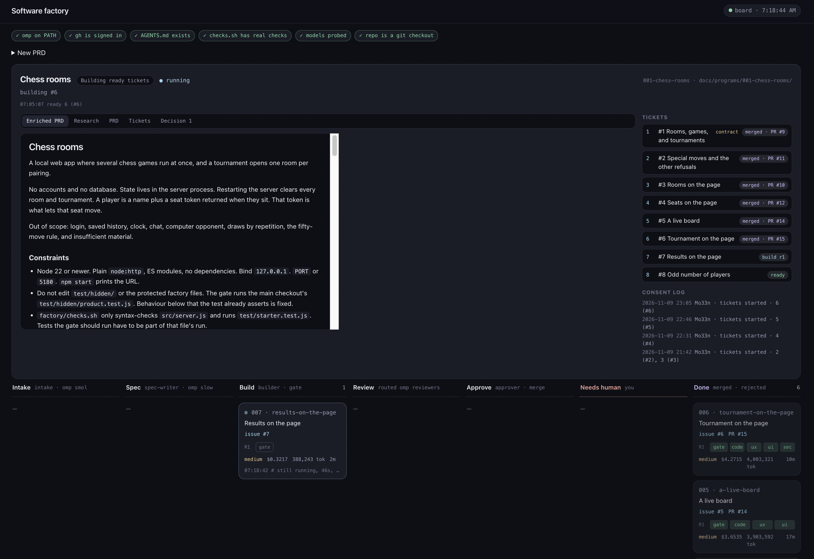

# Software Factory

Paste a product idea. Get pull requests.



This is a local factory for [omp](https://omp.sh). You stay on one board. The factory researches the repo, writes tickets, and runs each ticket through spec, build, checks, review, and approve. You press the buttons that matter. It does not deploy.

## You need

- [omp](https://omp.sh) 18+ (`brew install can1357/tap/omp`)
- `python3` 3.10+, git, and `gh` logged in to the repo
- Models omp can call tools with. Put their selectors in `factory/config.json`
- For a web app, `agent-browser` (`npm install -g agent-browser && agent-browser install`)

## Start here

```bash
python3 factory/bin/board
```

Open http://127.0.0.1:8000/ and paste a PRD.

The board asks you to approve the enriched PRD, then the ticket list. After that it files GitHub issues and builds every ticket that is ready. Cards refresh on their own. Check back with the board, or with `/factory status` inside omp.

## The ride

```
PRD → research → you approve → tickets → you approve
                      ↓
        each ticket: intake → spec → build → gate → review → approve → PR
                      ↓
        you merge, or send it back → release note → you accept
```

Nothing skips the approvals. Each one is a button on the board and a line in `docs/programs/<id>/`.

Change your mind in the box on the program card. The planner rewrites the ticket list and shows you the diff before filing anything.

A question only you can answer becomes a decision. The ticket waits until you answer.

## Tickets

A ticket header looks like this:

```markdown
## 3. Room list page
Depends: 1
After: 2
Touches: web/rooms
```

`Depends` waits for those pull requests to merge. `After` is only an order. `Touches` is an area: two ready tickets that share one run one at a time. `Kind: contract` lands a shared interface first. `Kind: spike` delivers a document.

Only issues labeled `factory` run.

## What the gate will not let through

- A failing `factory/checks.sh`.
- A shipped test that a later branch edits or deletes. Those copies live in `factory/contract/frozen/`.
- A web page with no button and no input, once `page.start` is set.
- A review that does not name a command it ran and the exit code it got.

`auto_merge` is off. A web repo stays that way until `page.start` is set. You merge the pull request, or send `/factory feedback`.

```json
"page": { "start": "node src/server.js", "port_env": "PORT", "path": "/" }
```

After a merge, the factory fast-forwards the checkout you run. If that checkout is dirty or has diverged, it says so and leaves it alone.

## Commands

In omp, `/factory` is the board's terminal twin. Restart omp once after adding `.omp/commands/factory.md`.

| You type | What happens |
|---|---|
| `/factory board` | Opens the board |
| `/factory status` | Queue, cost, tokens |
| `/factory run` | Drains every open `factory` issue |
| `/factory run 12` | Runs issue 12 |
| `/factory feedback 12 <text>` | Sends the job back to build |
| `/factory answer 12 <text>` | Answers a question on the issue |
| `/factory reject 12 <text>` | Drops a waiting job |

Same jobs, no omp session:

```bash
python3 factory/bin/program new "Chess rooms"    # PRD on stdin
python3 factory/bin/program step <id>
python3 factory/bin/run
python3 factory/bin/run status
```

## Install it into a repo

From the root of a project that already has a GitHub `origin`:

```bash
git clone --depth 1 https://github.com/Mo33n/software-factory.git /tmp/software-factory
rm -rf factory
cp -R /tmp/software-factory/factory ./factory
mkdir -p .omp/commands
cp /tmp/software-factory/.omp/commands/factory.md .omp/commands/factory.md
chmod +x factory/checks.sh factory/accept.sh factory/bin/*
rm -rf /tmp/software-factory
```

Then point `factory/checks.sh` at this repo's tests, set `models` in `factory/config.json` from `omp models`, and add the factory labels. For a web app, set `page.start` and install `agent-browser`. The checklist, gitignore lines, and the verify commands are in [INSTALL.md](INSTALL.md). [DESIGN.md](DESIGN.md) is how the pieces fit.

```bash
python3 factory/bin/board
```

Open http://127.0.0.1:8000/ and paste a PRD. Restart omp once so `/factory` shows up.

## License

[GPLv3](LICENSE).
